# Bug de Familia

**Historia de las seis especies**

*Documento de lore histórico — Borrador v0.1*

> **Estado de implementación:** este documento define las seis especies, pero el juego solo tiene la beta: 2 de 6 especies y 2 de 15 progenitores. Las otras especies, sus progenitores y sus zonas llegan en la post-beta (ver `03_ESTADO.md`).

> **Prevalece sobre este documento (8-nov):** Mohócratas y Grux llegaron a este planeta después del colapso. Las otras dos razas alienígenas ya estaban, y todas se conocían fuera de él: su intervención en sucesos anteriores fue desde fuera.

> Borrador narrativo v0.1. Vale esta historia larga; dos razas alienígenas llegaron a este planeta antes del colapso y dos después (P-18). Los humanos existieron y desaparecieron (8-nov).

## 1. Los Plegados

### Naturaleza y civilización

Los Plegados son seres planos capaces de doblar sus cuerpos en múltiples direcciones. Su anatomía les permite adoptar formas imposibles para otras especies: pueden convertirse en estructuras, esconderse dentro de pequeños espacios o plegarse sobre sí mismos hasta desaparecer aparentemente.

Su civilización se desarrolló alrededor del concepto de clasificación. Para ellos, todo debe tener una categoría, una posición y una relación con el resto de las cosas. Sus ciudades están construidas mediante capas, esquinas, pasillos plegados y edificios que pueden cambiar de configuración.

Su mayor logro cultural fue la Gran Clasificación, un sistema que pretendía catalogar todo lo existente.

### Dirigentes históricos

- **La Doblez Mayor:** primera autoridad reconocida de los Plegados.
- **Don Pliegue de Narices:** presidente reformista que intentó modernizar la administración.
- **Doblina VII:** dirigente durante la expansión de los archivos.
- **El Excelentísimo Señor Solapón:** presidente durante la Guerra de las Esquinas.
- **La Marquesa de la Solapa:** aristócrata y figura política de gran influencia.

### Héroes y figuras legendarias

- **Capitán Origami del Apocalipsis:** héroe de la Guerra de las Esquinas.
- **Santa Esquinia de los Siete Pliegues:** figura religiosa y protectora de los refugiados.
- **General Dobladillo:** estratega militar que consiguió evacuar varias ciudades.
- **Don Cartulino:** explorador de regiones plegadas.
- **La Niña Acordeón:** leyenda popular capaz de atravesar espacios imposibles.

### Farándula y cultura popular

- **Papelucho Superstar:** cantante de baladas geométricas.
- **Plié Plié:** estrella de danza y televisión.
- **El Excelentísimo Señor Solapón:** también protagonista de numerosos programas de humor político.
- **La Marquesa de la Solapa:** celebridad habitual de la prensa rosa.

### Acontecimientos históricos

#### La Gran Clasificación

Los Plegados desarrollaron un sistema para clasificar todos los objetos, seres y fenómenos conocidos. El sistema se volvió tan complejo que terminó generando categorías para las propias categorías.

La administración empezó a necesitar más recursos para mantener el sistema que para gobernar.

#### La Guerra de las Esquinas

Durante una época de expansión, los Plegados desarrollaron una tecnología capaz de comprimir regiones enteras del espacio.

Los Grux financiaron parte de los experimentos, los Ecos transmitieron las instrucciones y los Jubilados de Hierro mantuvieron las instalaciones.

El experimento inicial parecía un éxito. Sin embargo, los Plegados ocultaron que la tecnología también podía comprimir materia viva.

La guerra comenzó cuando distintas facciones intentaron controlar las instalaciones y sus mapas.

#### El Apocalipsis del Despliegue

Las instalaciones recibieron órdenes contradictorias. Algunas regiones comenzaron a desplegarse, mientras otras quedaron comprimidas.

Ciudades enteras cambiaron de posición o desaparecieron de los mapas.

Muchos Plegados sobrevivieron refugiándose en pliegues y espacios que ya no aparecían en los registros oficiales.

### Facciones actuales

- **Archivistas:** quieren recuperar la Gran Clasificación.
- **Desplegadores:** buscan liberar todas las regiones comprimidas.
- **Sin Pliegue:** rechazan la antigua estructura social.
- **Orden de la Esquina:** defienden el uso militar de la tecnología.

### Secretos y misterios

- Existen archivos que contienen información sobre seres vivos.
- Parte de la tecnología podría proceder de una civilización anterior.
- Algunos Plegados podrían conocer la existencia de instalaciones que ninguna especie recuerda.

### Hechos actuales

- En la **Cumbre de los Pliegues**, los Archivistas catalogan grietas a razón de tres por siglo.
  Los Desplegadores quieren desplegar la cumbre entera; los Archivistas lo impiden presentando
  formularios que también hay que clasificar.
- En el **Archivo de las Esquinas** comparten estanterías con Jubilados de Hierro. Los robots
  archivan por sentimiento («esta biela me la arregló mi cuñado») y los Plegados por código; cada
  cadáver termina con dos fichas distintas y una disputa formal por acta. El cadáver no firma:
  es lo único decente del expediente, y se lo discuten igual.
- En el **Camino de los Dientes** operan un puesto de peaje plegado que cobra «uso de esquinas
  ajenas». Los Grux tasaron el puesto en 0 dientes; el puesto archivó la tasación como «ofensa
  histórica, categoría provisional». Provisional desde hace un siglo: su forma de decir eterno.
- En el **Valle de las Esquinas**, la Orden de la Esquina entrena giros de 90 grados en combate.
  Los Grux venden entradas para verlos y se quedan la taquilla; los Plegados siguen sin enterarse
  de que cobran por verlos. El aplauso lo archivan como «ruido sin ficha», y así no existe.
- En la **Antecámara**, exploradores plegados afirman haber encontrado una esquina que no figura en
  ningún mapa. Se turnan para vigilarla 24 horas al día. Nadie ha visto nada y nadie se atreve a
  irse: abandonar el turno exigiría archivar el abandono.
- En el **Enchufe** (cupo reducido) han presentado una queja oficial porque no cabe su archivo
  portátil. La queja ocupa más espacio que el archivo. La de la queja ya pide cupo, y no cabe.

### Versiones sesgadas de la historia

> Versiones subjetivas y parciales. No son la verdad: cada especie cuenta lo que le conviene.

- **Guerra de las Esquinas:** «fue un traslado administrativo de gran calado; las bajas son erratas
  de archivo». Niegan haber ocultado nada: comprimir materia viva era «un detalle técnico pendiente
  de clasificar».
- **Gran Emisión:** «era un orden del día cósmico y nadie lo leyó». Culpan a los Ecos de
  transmitirlo en voz alta sin autorización de acta.
- **Apocalipsis del Despliegue:** versión oficial: «fue un despliegue exitoso de documentación».
  Las ciudades perdidas constan como «archivadas en otra carpeta». Esa carpeta no tiene código.
- **Colapso:** «no hubo colapso; hubo una reorganización de inventario a escala planetaria que aún
  está en curso». El inventario sigue abierto. El planeta, por educación, ya consta como cerrado.
- Sobre Mohócratas y Grux: «llegaron tarde y están fuera de toda clasificación oficial: son
  "contenido sin categoría"». En su idioma: sobras. Las sobras no se archivan, se apartan.

### Manías y peculiaridades

- **Se distraen si les das un objeto para clasificar:** se detienen en pleno combate a etiquetar la
  piedra que les has lanzado. Es la forma más barata de escapar de uno.
- Antes de entrar en cualquier estancia la miden en pliegues («14 pliegues y medio; indecente»).
- No se sientan: se pliegan en el «pliegue de cortesía», que desde fuera parece una silla. Sentarse
  encima es declaración de guerra o de cariño, según la facción.
- Si ven un mapa mal doblado lo corrigen compulsivamente, aunque sea el mapa de la huida de su
  interlocutor. Luego se ofenden: huir con el mapa bien doblado sí que es una falta.
- Consideran los ángulos rectos «la única postura decente» y esquivan las esquinas redondeadas por
  pudor.
- Anuncian cada pliegue en voz alta («pliegue tres, con permiso»). Si nadie contesta, gritan el
  formulario. Su idea de diálogo es un acta con volumen.

### Leyendas urbanas falsas

> Lo que los Plegados creen de las OTRAS especies. Falso, pero lo cuentan como hecho.

- Los Ecos repiten palabras porque un tribunal antiguo los condenó: «están todos en testigo
  perpetuo».
- Los Jubilados se pliegan al apagarse: «el metal recuerda la forma y se dobla solo; por eso al
  alba están en otra postura».
- El estómago-bolsillo de los Grux es un archivo portátil robado, y dentro hay una clasificación
  perfecta que quieren recuperar.
- Los sombreros de chatarra de los Mohócratas son «pliegues fallidos»: seres que intentaron
  plegarse y les salió redondo. Lo redondo, para ellos, es un error que además cría hongos.

### Rituales

- **El Saludo del Acordeón:** se despliegan y repliegan tres veces con ruido de fuelle. Un cuarto
  despliegue es insulto; medio despliegue, coqueteo administrativo.
- **El Juramento de la Esquina:** al entrar en casa giran 90 grados y se quedan un minuto mirando
  la esquina «por si alguien la necesita». Nadie la ha necesitado. El minuto se cumple con rencor.
- **El Acta Plegada:** cada día doblan un acta con lo ocurrido y la meten en una grieta. Las
  grietas del Valle de las Esquinas son, en realidad, el archivo histórico más completo del mundo;
  nadie lo sabe porque nadie sabe leer el orden de los pliegues.

### Secretos ridículos

- **El octavo pliegue:** existe un octavo pliegue secreto que solo dominan los archivistas
  veteranos. Doblarlo ocho veces vuelve invisible una tarde exacta, pero deja una arruga que no se
  quita; por vergüenza, todos niegan saberlo.
- **El cajón X:** en el Archivo de las Esquinas hay un cajón clasificado como «categoría X: cosas
  que no queremos clasificar». Está vacío. Lo vigilan tres turnos al día para que siga vacío,
  porque si alguien mete algo, habría que clasificarlo.

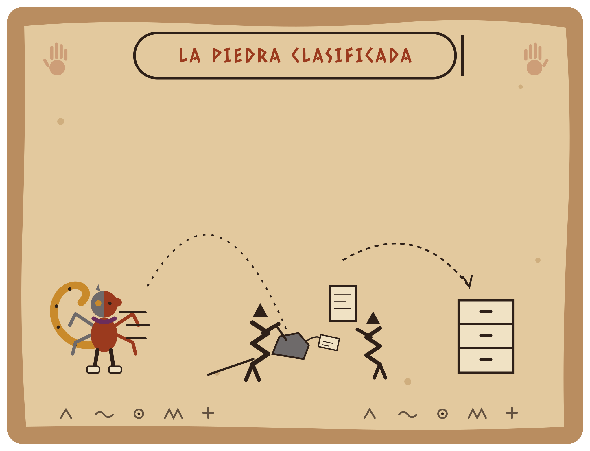
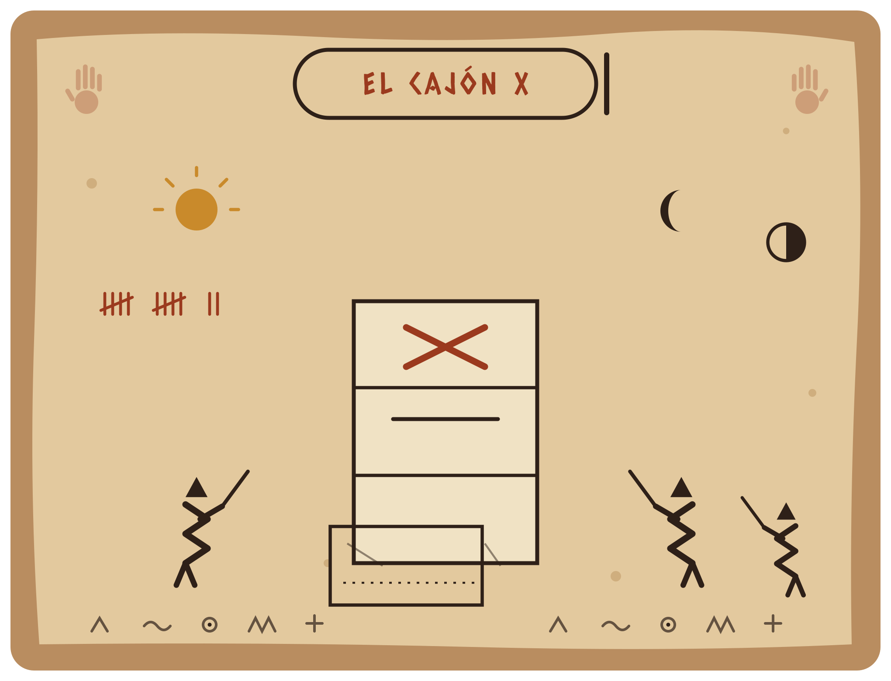

## 2. Los Ecos de Vurm

### Naturaleza y civilización

Los Ecos de Vurm son seres acústicos cuya existencia depende del sonido. Su forma física es inestable y puede variar según la frecuencia, el volumen y el entorno.

Conservan parte de su memoria repitiendo sus últimas palabras. Para ellos, escuchar es una forma de existir.

Sus ciudades se construyeron alrededor de cámaras de resonancia, túneles acústicos y grandes estructuras capaces de almacenar sonidos.

### Dirigentes históricos

- **Vurm el Primero:** figura fundacional de su civilización.
- **Doña Repetición Perpetua:** dirigente durante la expansión de las ciudades resonantes.
- **Barítono Supremo:** líder político y militar.
- **Señor Eco-Lógico:** impulsor de la organización de las comunicaciones.
- **Vurm el Último:** dirigente durante los últimos años de la civilización.

### Héroes y figuras legendarias

- **Tenor del Abismo:** explorador de regiones sin sonido.
- **La Soprano de las Mil Voces:** capaz de reproducir voces de otras especies.
- **Don Reverberencio:** héroe de la Gran Emisión.
- **El Niño del Último Suspiro:** leyenda relacionada con la supervivencia durante el Apocalipsis del Silencio.

### Farándula y cultura popular

- **DJ Reverberón:** estrella de la música electrónica acústica.
- **Ruperto Decibelio:** presentador de televisión.
- **Los Últimos del Karaoke:** grupo musical famoso por sus conciertos interminables.

### Acontecimientos históricos

#### La Gran Emisión

Los Ecos encontraron una señal automática procedente de una infraestructura antigua.

Creyeron que era un mensaje cósmico y comenzaron a amplificarla.

La señal terminó interfiriendo en sistemas de navegación, comunicación, comercio y servicios.

Los Jubilados intentaron solucionar el problema mediante una actualización remota, pero la intervención propagó el fallo a otros sistemas.

La señal contenía instrucciones destinadas a una infraestructura que ninguna de las seis especies comprendía por completo.

#### El Apocalipsis del Silencio

La propagación de la señal y los fallos de comunicación provocaron regiones donde el sonido desapareció o dejó de comportarse de forma normal.

Algunos Ecos perdieron su forma física. Otros quedaron atrapados repitiendo fragmentos de conversaciones antiguas.

### Facciones actuales

- **Resonantes:** quieren recuperar las grandes cámaras de sonido.
- **Susurrantes:** prefieren vivir con sonidos mínimos.
- **Amplificados:** creen que la Gran Emisión contenía una verdad superior.
- **Mudos:** rechazan depender del sonido para existir.

### Secretos y misterios

- La Gran Emisión continúa transmitiéndose en algún lugar.
- Algunos Ecos reproducen mensajes que nunca escucharon conscientemente.
- Existen voces desconocidas dentro de las grabaciones más antiguas.

### Hechos actuales

- En la **Cámara de Resonancia** ensayan la «Emisión Conmemorativa Anual»: repiten la Gran Emisión
  entera de memoria. Dura once días. La Manada del **Polígono de Reparto** vecino la confunde con
  una orden de reparto y sale en estampida.
- En el **Cañón del Eco** cobran entrada por escuchar tu propio eco. Los Grux tasaron el eco en 0
  dientes y han montado un mercado paralelo de ecos de segunda mano; los Ecos lo consideran
  canibalismo con ticket.
- En la **Colmena Fúngica** negocian conversación fresca a cambio de fertilizante. Los Mohócratas
  votan cada frase antes de decirla y los Ecos se quejan de que «sabe a votación».
- Los **Amplificados** llevan décadas pidiendo reamplificar la señal original; los **Mudos** llevan
  décadas pidiendo un minuto de silencio. Las dos peticiones siguen en trámite, lo cual les parece
  a ambos una obscenidad con sello. El sello también está en trámite: su idea de urgencia.
- En el **Valle de las Esquinas** un Eco quedó atrapado repitiendo la última palabra de un Plegado:
  «acta». Lleva cuarenta años diciendo «acta». Los Archivistas lo consideran la mejor fuente
  histórica viva y no lo apagan por razones de patrimonio. El Eco pidió el alta. Negada por acta.

### Versiones sesgadas de la historia

> Versiones subjetivas y parciales. No son la verdad: cada especie cuenta lo que le conviene.

- **Gran Emisión:** «fue nuestro mayor descubrimiento y nos lo estropearon: los Jubilados metieron
  una actualización a mitad del concierto».
- **Apocalipsis del Silencio:** «no fue hambre nuestra, fue sabotaje silencioso; los sospechosos
  son todos los que no hablan». Los Mudos están indignados por la acusación y dicen muy poquito.
- **Guerra de las Esquinas:** «la transmitimos nosotros, luego la historia es nuestra; los Plegados
  solo pusieron el decorado».
- **Colapso:** «se acabó la conversación, y sin conversación no hay mundo. La culpa es de quien se
  apaga a las 21:00».
- Sobre su origen: sostienen que Vurm el Primero nació de la primera broma del universo, y que la
  broma era sobre los humanos. Se extinguieron a mitad del chiste. El remate, dicen, mejora.

### Manías y peculiaridades

- **Deben repetir la última palabra antes de responder.** Si la última palabra fue un insulto, el
  insulto va primero y la cortesía después («...insulto. Buenos días, insulto.»).
- **Se debilitan en zonas de silencio.** Evitan el **Desguace de las Nueve** a partir de las 21:00,
  al que llaman «la zona que mata».
- No soportan los susurros: la comida envasada les sienta mal.
- Se alimentan de conversaciones y siguen a un grupo durante horas esperando algo interesante; los
  monólogos de los Jubilados les producen indigestión aguda.
- Aplauden sus propios ecos y abuchean los ajenos.
- Cantan en karaoke lo que acaban de oír, sin permiso ni vergüenza. El público es el que acaba de
  hablar, y aplaude para que el estribillo no le caiga encima.

### Leyendas urbanas falsas

> Lo que los Ecos creen de las OTRAS especies. Falso, pero lo cuentan como hecho.

- Los Plegados son sordos: por eso etiquetan todo. «Si oyeran, no necesitarían tantas etiquetas.»
- Los Jubilados tienen un «modo fiesta» a las 3 de la madrugada; los Ecos afirman haberlo grabado,
  pero la cinta solo contiene un viento lejano.
- Los navegadores de la Manada retransmiten pensamientos caninos en onda corta; varios DJs los
  emiten como música ambiental.
- Los Grux cuentan dinero en «lengua de dientes»; en realidad es la digestión, pero suena muy
  oficial.

### Rituales

- **El Responso del Eco:** antes de responder cualquier pregunta hay que repetir la última palabra
  del que pregunta. Responder directo se considera maleducado y un poco caníbal.
- **El Karaoke del Ocaso:** al caer la tarde, cada Eco repite la mejor frase que ha oído ese día.
  Si dos repiten la misma, duelo de volumen; en la Cámara de Resonancia ha derribado ya dos
  estalactitas y una urna funeraria ajena.
- **La Consagración del Eslogan:** los anuncios que sobreviven del mundo de antes se consideran
  escritura sagrada. Recitarlos en orden se llama «la liturgia del eslogan». La más santa acaba
  en «llame ya». Nadie llama. La fe no admite devoluciones.

### Secretos ridículos

- **Repetir publicidad dormidos:** en sueños recitan anuncios de antes del colapso. Los más
  piadosos amanecen recitando ofertas de yogur y pasan el día en modo susurro, que es su estado más
  débil: un círculo vicioso con colchón.
- **El tono de ocupado:** la grabación venerada de «Vurm el Primero», la más antigua de todas, es
  en realidad un tono de línea ocupada. Tres eruditos lo saben. Los tres son Mudos, y no pueden
  contarlo sin dejar de existir.

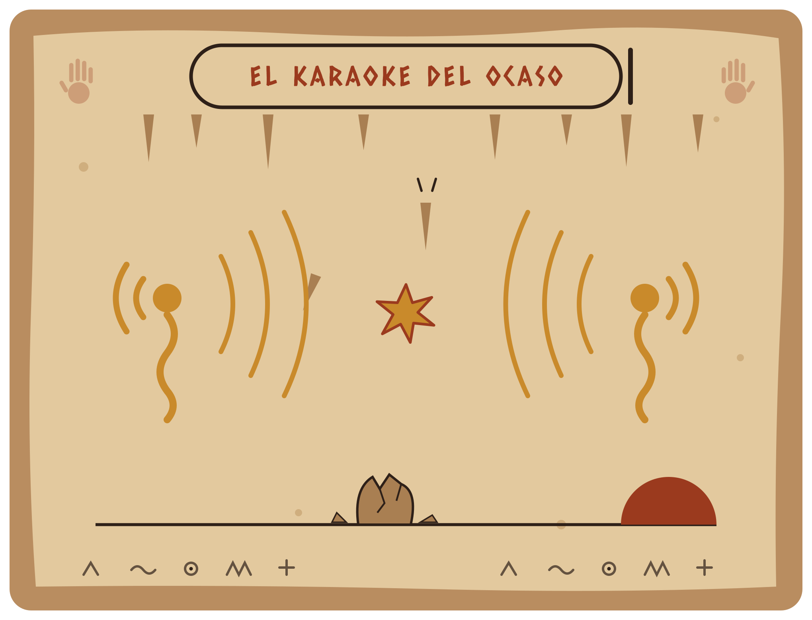
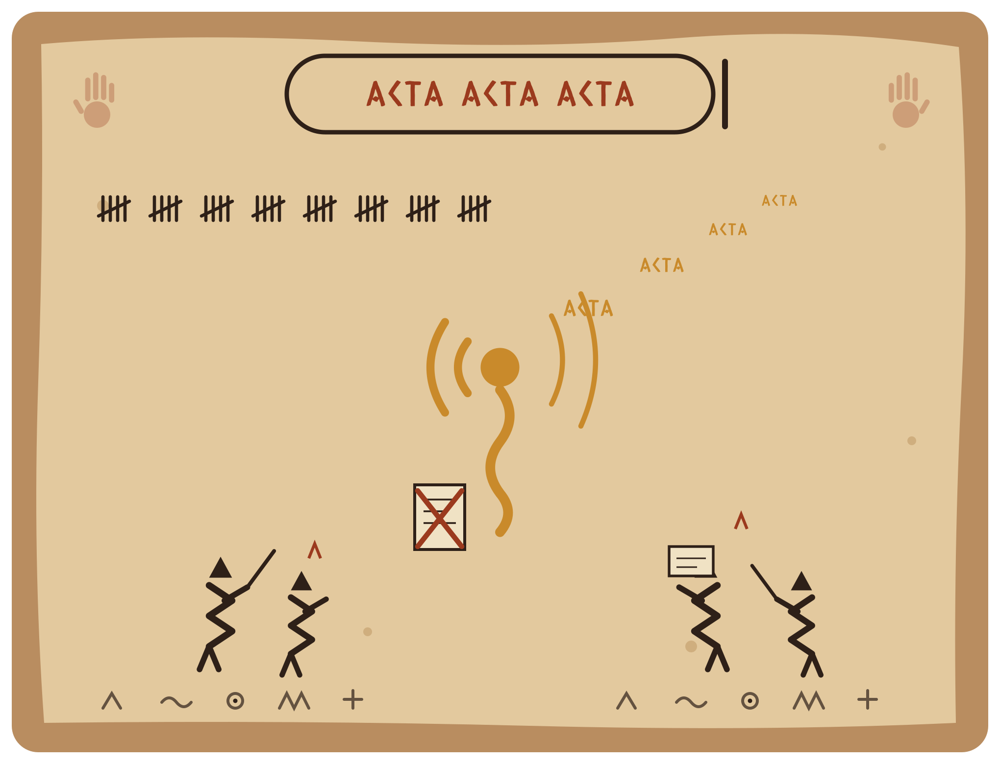

## 3. Los Mohócratas

### Naturaleza y civilización

Los Mohócratas son colonias fúngicas inteligentes que utilizan sombreros de chatarra como parte de su identidad física y social.

Su organización política se basa en la democracia de esporas. Las decisiones importantes requieren varias votaciones y, en ocasiones, una votación para decidir si las votaciones anteriores fueron válidas.

Son expertos recicladores de robots, maquinaria y materiales orgánicos.

### Dirigentes históricos

- **Presidenta Esporalia:** primera dirigente de la Asamblea.
- **Don Champiñón de los Votos:** político famoso por sus discursos interminables.
- **Seta Primera:** dirigente de la expansión micelial.
- **El Gran Micelio:** autoridad de la red biológica.
- **Alcalde Moho II:** presidente durante los años de mayor tensión política.

### Héroes y figuras legendarias

- **General Esporón de la Trinchera:** héroe militar.
- **Santa Micelia:** protectora de las colonias.
- **El Sombrerero de Hierro:** reciclador que salvó a miles de Mohócratas.
- **Compostino el Incorruptible:** político que se negó a aceptar sobornos.

### Farándula y cultura popular

- **Seta Barroca:** estrella de televisión.
- **DJ Esporadic:** músico de baile.
- **Los Hongos del Ritmo:** grupo musical.
- **Charly Compost:** humorista y presentador.

### Acontecimientos históricos

#### La Primera Asamblea

Los Mohócratas organizaron su primera gran estructura democrática.

Su sistema exigía tres votaciones:

1. Votar la propuesta.
2. Confirmar la votación.
3. Decidir si las dos votaciones anteriores eran válidas.

El sistema produjo una enorme estabilidad institucional y una lentitud administrativa legendaria.

#### La Revolución de los Sombreros

Una parte de la población comenzó a rechazar los sombreros de chatarra como símbolo de estatus.

El conflicto terminó dividiendo a la sociedad entre tradicionalistas y renovadores.

#### La Crisis de las Esporas

Los Grux comenzaron a comerciar con información procedente de la red biológica de los Mohócratas.

Algunas sustancias alteraron la comunicación entre colonias. La red se fragmentó y parte de la memoria colectiva quedó aislada.

#### El Apocalipsis de la Luz

La alteración de las condiciones ambientales y los sistemas de iluminación provocó un colapso de las zonas de cultivo y comunicación.

Muchas colonias sobrevivieron refugiándose bajo tierra o en estructuras abandonadas.

### Facciones actuales

- **Micelio Libre:** buscan reconstruir la red biológica.
- **Tres Votos:** defienden el sistema democrático tradicional.
- **Carroñeros de Hierro:** reciclan maquinaria antigua.
- **Seta Negra:** grupo hermético que busca controlar las esporas.

### Secretos y misterios

- La red original podría conservar recuerdos de antes del colapso.
- Algunos recuerdos de otras especies podrían estar almacenados en ella.
- Existen colonias que parecen responder a estímulos procedentes de instalaciones antiguas.

### Hechos actuales

- En la **Asamblea de las Esporas** se vota la cuarta votación sobre las tres primeras. Lleva
  catorce años. La propuesta original era poner un banco; el banco ya no existe, la votación sí.
- En los **Talleres de Abuela RAM** reciclan chatarra junto a los Jubilados. Los Mohócratas llaman
  «material» a los robots muertos y los Jubilados llaman «difuntos» a ese material. Ha habido
  insultos formales por acta y una reprimenda conjunta. La votaron. Empate. Votaron el empate.
  Sigue empatado: así ganan los dos y no arreglan nada, que es su obra maestra.
- En el **Gran Mercado** someten a votación los precios de todo: un tomate necesita tres votos y un
  anexo regulatorio. Los Grux venden en la puerta «precios tasados al contado, sin acta», y el
  público agradece la prisa.
- En el **Atajo de las Esporas** votaron cerrar el giro a la derecha para «frenar el tráfico». La
  Manada, que solo gira a la derecha, lleva semanas orbitando el paso. Han convocado votación de
  emergencia sobre si es un problema. Tres veces.
- En el **Paso de las Nueve** reciclan robots retirados mientras los Jubilados los miran en
  silencio desde el otro lado del paso, lo cual consideran «una abstención hostil».

### Versiones sesgadas de la historia

> Versiones subjetivas y parciales. No son la verdad: cada especie cuenta lo que le conviene.

- **Llegada al planeta:** «llegamos antes que nadie; consta en acta». Nadie ha encontrado el acta;
  el acta de búsqueda del acta también está en trámite.
- **Guerra de las Esquinas:** «la mediamos nosotros con tres votaciones; el alto el fuego se aprobó
  por mayoría, recuento y confirmación del recuento».
- **Crisis de las Esporas:** «los Grux comerciaron con nuestra red biológica: fue un robo, aunque
  el recibo diga "compra"».
- **Colapso:** «avisamos por acta varias veces; nadie quiso votar a tiempo. El mundo se acabó por
  falta de quorum».
- **Gran Emisión:** «la oímos primero y decidimos no votar sobre ella, que es la decisión más
  responsable de la historia». También la menos votada: les quita el acta, no el sueño.

### Manías y peculiaridades

- **Votan todo tres veces:** la propuesta, la confirmación y la validez de las dos anteriores. Se
  han votado hasta si respirar (a favor, por poco).
- Odian la luz: la consideran «un abuso de poder con lumbre».
- Los votos se compran con fertilizante, y los sobornos se declaran por transparencia, lo que los
  vuelve legales, masivos y muy rentables para el vendedor de fertilizante.
- La abstención es una forma de vida: hay un abstencionista tan comprometido que lleva nueve años
  sin confirmar su propio nombre.
- Someten a votación partes de su cuerpo antes de moverlas; los pies suelen perder.

### Leyendas urbanas falsas

> Lo que los Mohócratas creen de las OTRAS especies. Falso, pero lo cuentan como hecho.

- Los Jubilados tienen un «modo fiesta» a las 3 de la madrugada que nadie ha visto. Se cita como
  argumento: «si se apagan a las 21:00, algo tienen que hacer a las 3».
- Los Grux guardan en el estómago-bolsillo un «parlamento portátil» donde votan leyes sin acta, lo
  cual les parece una aberración y también una envidia.
- La Manada reparte paquetes vacíos porque los Mohócratas ya se comieron el contenido en una
  asamblea anterior que nadie recuerda.
- Los Plegados se pliegan para no votar: «doblando el cuerpo te abstienes de postura».

### Rituales

- **La Enmienda del Plato:** antes de comer votan qué comer, tres veces. En años malos comen
  abstención.

### Secretos ridículos

- **El más hongo:** votan en secreto quién es «el más hongo». El concurso no tiene premio ni
  criterios, y el ganador lleva doscientos años siendo el mismo sombrero de chatarra, ya más
  oxidado que orgulloso.
- **La receta fundacional:** el acta de la Primera Asamblea es en realidad una receta de sopa que
  se leyó en voz alta por error y gustó tanto que se archivó como constitución. Los Cocina-Comités
  la siguen interpretando cada invierno. Nadie ha catado la sopa. La ley, sí, y sabe a caldo frío.

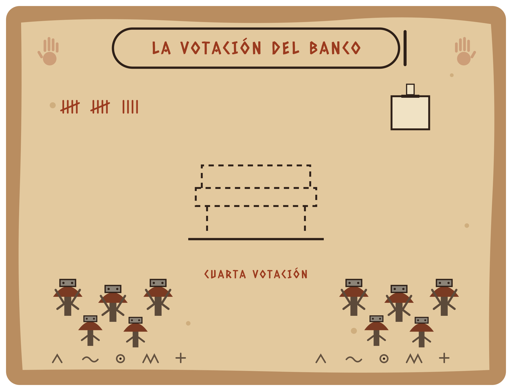
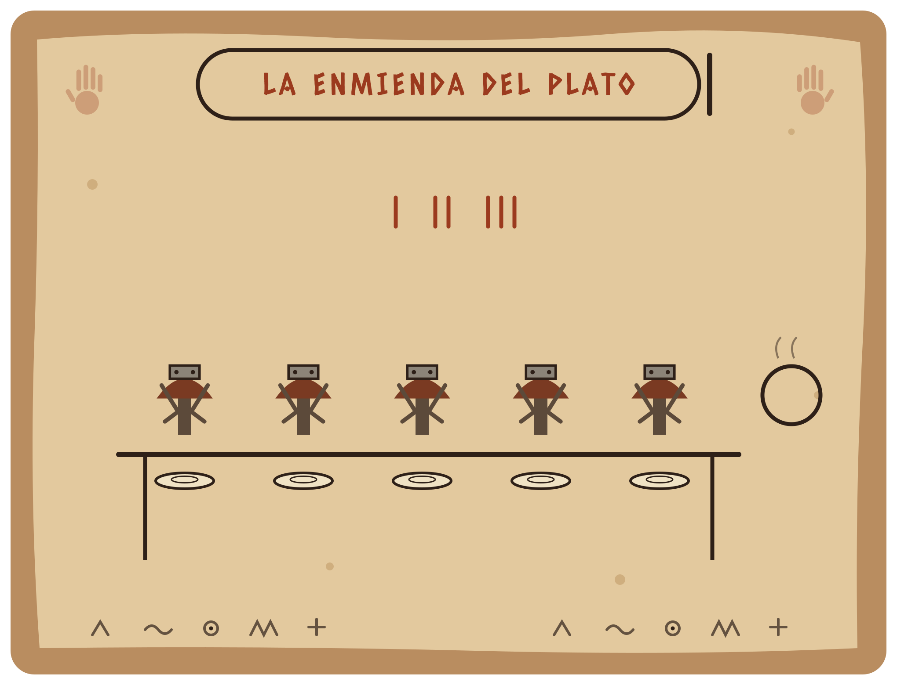

## 4. Los Tasadores Grux

### Naturaleza y civilización

Los Grux son seres de cuatro brazos con un estómago-bolsillo capaz de almacenar objetos.

Su civilización se desarrolló alrededor del comercio, los préstamos y la valoración de bienes.

Para ellos, prácticamente todo tiene un precio: los dientes, las extremidades, los recuerdos, los favores y hasta las posibilidades futuras.

Su economía se basa en complejos sistemas de deuda y garantías.

### Dirigentes históricos

- **Don Dientefino:** fundador de las primeras grandes casas comerciales.
- **Presidenta Doña Mordisquitos:** dirigente de la expansión económica.
- **Mariscal Interés Compuesto:** líder durante la Guerra de Intereses.
- **El Gran Tasador:** autoridad de los mercados.
- **Don Mordisco de Oro:** presidente durante la Gran Burbuja de los Dientes.

### Héroes y figuras legendarias

- **El Cobrador de los Mil Dientes:** personaje legendario de la Guerra de Intereses.
- **Doña Tasa Cero:** defensora de los deudores.
- **Capitán Estómago Profundo:** explorador de objetos perdidos.
- **San Mordisquito:** protector de los comerciantes arruinados.

### Farándula y cultura popular

- **Don Chanchullo:** presentador de televisión.
- **Mordisquito Deluxe:** celebridad y empresario.
- **Los Intereses Variables:** grupo musical.
- **La Duquesa del Embargo:** protagonista habitual de la prensa rosa.

### Acontecimientos históricos

#### El Descubrimiento del Estómago-Bolsillo

Los Grux descubrieron que podían utilizar su anatomía para almacenar objetos y mercancías.

Esto transformó su economía y permitió desarrollar redes comerciales mucho más complejas.

#### La Gran Burbuja de los Dientes

Los dientes se convirtieron en un activo financiero de enorme valor.

Se concedieron préstamos respaldados por dientes futuros, dientes heredados e incluso dientes todavía no desarrollados.

La burbuja terminó provocando una crisis económica generalizada.

#### La Guerra de Intereses

Las grandes casas comerciales comenzaron a enfrentarse por el control de rutas, deudas y territorios.

La guerra afectó a otras especies mediante préstamos, financiación militar y manipulación de suministros.

#### El Apocalipsis de la Deuda

El sistema financiero dejó de distinguir entre deudas reales, deudas heredadas y obligaciones creadas por errores administrativos.

Muchos Grux descubrieron que debían cantidades imposibles a entidades que ya no existían.

### Facciones actuales

- **Acreedores:** quieren recuperar las antiguas deudas.
- **Deudores Libres:** rechazan el sistema financiero.
- **Familia del Mordisco:** organización mafiosa.
- **Tasadores Independientes:** comerciantes que trabajan fuera de las grandes casas.
- **Sin Dientes:** movimiento de resistencia económica.

### Secretos y misterios

- Existe un registro financiero universal.
- Algunas deudas parecen haber sido creadas antes de que existieran sus deudores.
- Los registros comerciales contienen mapas de instalaciones antiguas.
- Los Grux podrían haber financiado indirectamente la Gran Emisión.

### Hechos actuales

- En la **Lonja de los Dientes** cotizan los dientes en bolsa. Los Jubilados empeñan piezas y
  recuerdos; el índice de referencia, el «Diente de Oro», sube cada vez que alguien suspira.
  Un gemido rinde más que una jornada. En la lonja se gime a propósito, y a eso lo llaman oficio.
- En el **Gran Mercado** tasan la entrada, la salida y la permanencia. Tasación oficial del
  protagonista: cabeza, 0 dientes, y el perito cobró plus por mirarla; pelo, sin peritar y mejor
  así; futuro, a la baja y sin pujas. Lote sin valor: ni de broma se lo queda nadie.
- En el **Camino de los Dientes** cobran peaje por el camino, por el arcén y por la idea de camino.
- En el **Cañón del Eco** intentan cobrar el eco («de la caja, caja»). Los Ecos responden
  repitiendo el recibo cuatrocientas veces hasta que se rinden.
- En el **Cementerio de Robots** compran los difuntos antes de que los entierren los Jubilados. Los
  Jubilados han empezado a enterrar de noche, lo que ha creado el «suplemento nocturno».
- En la **Cumbre de los Pliegues** patrocinan la Gran Clasificación con un interés del 400 %; los
  Plegados figuran en los libros como «clientes ilusionados». La ilusión también devenga interés.

### Versiones sesgadas de la historia

> Versiones subjetivas y parciales. No son la verdad: cada especie cuenta lo que le conviene.

- **Guerra de las Esquinas:** «la financiamos con un préstamo solidario que nadie ha devuelto; de
  ahí la deuda universal, que es un malentendido cariñoso».
- **Crisis de las Esporas:** «fue una adquisición amistosa de una red biológica que estaba sin
  explotar».
- **Gran Emisión:** «la señal era un aviso de mercado; los que la amplificaron no leyeron la letra
  pequeña, lo cual nos parece imperdonable por no llevar comisión».
- **Colapso:** «fue una insolvencia del universo; tenemos el único registro de crédito que
  funciona, así que, técnicamente, somos los únicos sanos».
- Sobre los Jubilados: «nos deben electricidad desde antes de existir deudores; el apagón de las
  21:00 es un impago en masa».

### Manías y peculiaridades

- **Tasan todo lo que ven**, incluido el protagonista y a sí mismos en voz alta («yo valgo 12
  dientes, rebajado»).
- Nunca dicen «gratis»: dicen «con precio pendiente de tasación».
- Regatean consigo mismos antes de salir de casa; pierden siempre, y la pérdida se apunta.
- Si huelen azufre vomitan lo robado; por eso a los apagafuegos de negocios los pagan en otro olor.
- Cuatro brazos en turnos: uno cuenta, otro firma, el tercero recoge y el cuarto gesticula
  amenazante por descanso rotativo.
- Cobran por las frases retóricas («eso no es una pregunta, es una tasación; 1 diente»).
  La respuesta, 2. El silencio, 3: es el producto estrella, y lo pagas tú sin abrir la boca.

### Leyendas urbanas falsas

> Lo que los Grux creen de las OTRAS especies. Falso, pero lo cuentan como hecho.

- El apagón de las 21:00 de los Jubilados es un impago colectivo de la luz; al alba refinancian
  entre ellos en chispazos.
- Los tres votos de los Mohócratas son una operación de blanqueo de fertilizante.
- Los paquetes de la Manada van llenos de dientes, y por eso los interceptan desde hace
  generaciones. Van vacíos. Nadie se lo ha querido confirmar: la verdad no factura, y el rumor sí.
- Dentro de los Plegados hay una bóveda: llevan siglos buscando «el pliegue con caja fuerte». Los
  Plegados dejan buscar. 1 diente la hora.

### Rituales

- **El Tributo del Aire:** en cualquier estancia cerrada, el primero que respira tasa el aire y
  reparte el oxígeno por tramos. En el Gran Mercado hay lista de precios por litro respirado.
  Quien no paga, aguanta. Es su huelga, y la pierde por asfixia, que no admite aplazamiento.
- **El Bautizo del Diente:** el primer diente cobrado se nombra, se asegura y se presenta en
  sociedad. Los dientes heredados heredan también el nombre; hay dientes con genealogía más larga
  que las familias.

### Secretos ridículos

- **Deudas imposibles:** existen deudas anteriores a la existencia de los deudores. La Familia del
  Mordisco lleva el registro y cobra «interés histórico». La deuda más antigua se la deben a sí
  mismos por servicios futuros ya prestados.
- **La tasación del planeta:** el Gran Tasador, máxima autoridad histórica en valoración, tasó una
  vez un planeta entero en 3 dientes. Estaba de mal humor y nadie se atrevió a replicar. Ese
  planeta es oficialmente el más barato del universo y nunca se ha vendido. A ese precio parece
  trampa. Lo es. Nadie regatea con quien tasa mundos a 3 y no admite réplica.

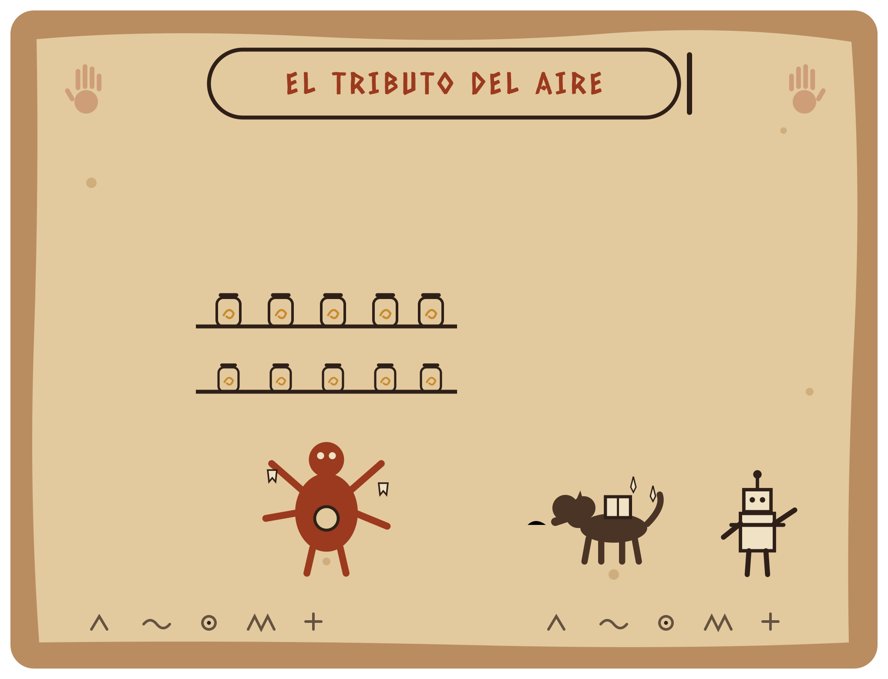
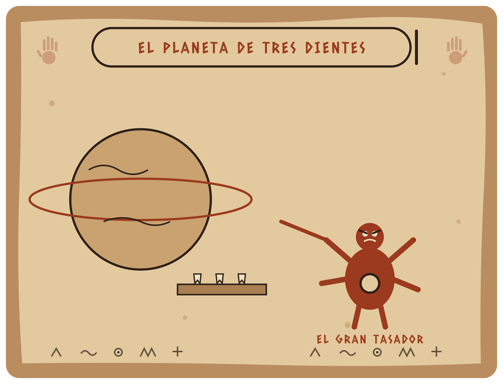

## 5. La Manada Recalculada

### Naturaleza y civilización

La Manada Recalculada es una especie animal inteligente cuyos antepasados fueron animales de servicio y compañía.

Con el paso del tiempo desarrollaron sistemas de navegación implantados y una cultura basada en las rutas de reparto.

Su sociedad considera que toda entrega debe completarse, aunque el destinatario haya desaparecido o la ciudad ya no exista.

La obligación de entregar un paquete puede mantenerse durante generaciones.

### Dirigentes históricos

- **Gran Guau Primero:** figura fundacional.
- **Presidenta Canela de la Correa:** dirigente durante la expansión de las rutas.
- **Comandante Guau-404:** líder militar durante la Gran Desviación.
- **Señor Mordedor de Mapas:** responsable de los sistemas de navegación.
- **Alcaldesa Chispa de la Esquina:** dirigente de una de las últimas ciudades.

### Héroes y figuras legendarias

- **Capitán Rastreador de la Última Entrega:** héroe de la Gran Desviación.
- **La Loba de las Mil Rutas:** exploradora legendaria.
- **Sargento Babas Binarias:** militar y navegadora.
- **San Perruno del Reparto:** protector de los repartidores.

### Farándula y cultura popular

- **DJ Chucho:** estrella de la música electrónica.
- **Los Caniches del Apocalipsis:** grupo de rock.

### Acontecimientos históricos

#### La Primera Ruta

La Manada desarrolló un sistema de rutas de reparto que conectaba asentamientos muy alejados.

La primera entrega se convirtió en una tradición sagrada.

#### La Revolución de los Repartidores

Los repartidores comenzaron a cuestionar las rutas impuestas por los sistemas centrales.

Muchos defendían que una entrega debía poder cancelarse cuando el destinatario ya no existía.

Los Grux manipularon algunas rutas para obtener beneficios comerciales.

Los Ecos transmitieron señales falsas que desviaron a miles de repartidores.

#### La Gran Desviación

Los sistemas de navegación comenzaron a enviar a la Manada hacia destinos inexistentes.

Algunos grupos desaparecieron durante años siguiendo rutas que no figuraban en ningún mapa.

#### El Apocalipsis del Destino

El sistema central dejó de reconocer los destinos válidos.

Muchos repartidores quedaron atrapados en rutas eternas, mientras otros comenzaron a crear sus propios mapas.

### Facciones actuales

- **Repartidores Eternos:** siguen cumpliendo las rutas antiguas.
- **Desviados:** rechazan la navegación central.
- **Rastreadores Libres:** crean nuevas rutas.
- **Guardianes del Paquete:** protegen las entregas antiguas.
- **Manada Central:** intenta recuperar el control del sistema.

### Secretos y misterios

- El sistema central de navegación podría seguir activo.
- Existe una última ruta que todavía no ha sido completada.
- Algunos paquetes contienen información anterior al colapso.
- El destino final de determinadas entregas parece proceder de una fuente desconocida.

### Hechos actuales

- En el **Polígono de Reparto** la ruta eterna número 9 sigue en curso: el destinatario vivía en un
  edificio que ya no existe y el paquete se hereda de generación en generación, con acuse
  pendiente. El acuse también se hereda. Nadie firma. Esperar es su único talento demostrable.
- En **La Última Ruta**, los Guardianes del Paquete custodian la última entrega pendiente. Los Grux
  ofrecen precios cada vez más absurdos; los Guardianes responden con el ladrido binario oficial de
  «no venta», que dura once minutos.
- En el **Atajo de las Esporas**, los Mohócratas votaron cerrar el giro a la derecha. La Manada
  lleva semanas orbitando el paso. Los Rastreadores Libres proponen girar a la izquierda; la
  propuesta provoca náuseas existenciales en la Manada Central.
- En el **Desguace de las Nueve** entregan piezas a una empresa de envíos que dejó de existir antes
  del colapso. La entrega consta «en camino», que es el estado oficial de toda su economía:
  el PIB, la fe y la excusa. Llegar no entra en el paquete.
- En la **Cámara de Resonancia**, los Ecos imitan el timbre de entrega y la Manada entra en frenesí
  de entrega, golpeando las paredes con el paquete. Los Ecos lo llaman «el mejor espectáculo
  acústico del mundo» y venden localidades.

### Versiones sesgadas de la historia

> Versiones subjetivas y parciales. No son la verdad: cada especie cuenta lo que le conviene.

- **Gran Desviación:** «los Ecos transmitieron señales falsas para robar los paquetes; el robo
  fracasó porque los paquetes no se abren, pero el daño moral es incalculable».
- **Colapso:** «la humanidad era nuestro personal de mantenimiento; cuando se fue, el mundo perdió
  la logística y, por tanto, el sentido». Ponían pilas y opiniones. Nadie reclama ninguna de las
  dos: las pilas estaban gastadas, y las opiniones, también.
- **Gran Emisión:** «fue un aviso de reparto perdido; si alguien lo hubiera escaneado con el
  hocico, todo seguiría en pie».
- Sobre los Jubilados: «fueron creados para abrirnos las puertas; su huelga nos dejó encerrados en
  un almacén cuarenta años, y ahí empezó todo».
- Sobre los Grux: «vendieron mapas falsos que desviaron a miles; el problema no es el engaño, es
  que los mapas eran malos y no llevaban marca de la casa».

### Manías y peculiaridades

- **Solo giran a la derecha.** Bloquea el giro derecho y la unidad se pierde, orbita en círculos o
  se sienta a esperar una señal que no va a llegar.
- **Obedecen ladridos en binario:** un «101» mal pronunciado los manda a otra zona.
- Deben olfatear todo paquete antes de confiar en él; los vacíos también, aunque huelen a
  «decepción». Tiene remitente. El remitente sigue esperando, que es peor que el vacío.
- Marcan las rutas dejando un paquete vacío cada cien pasos; su mapa del mundo es, en realidad, una
  fila de paquetes.
- Esperan sentados ante puertas cerradas de destinatarios muertos hace siglos; lo llaman «respeto
  al cliente».
- Persiguen cualquier cosa que se parezca a una furgoneta de reparto, incluidos los Mohócratas con
  sombreros cuadrados.

### Leyendas urbanas falsas

> Lo que la Manada cree de las OTRAS especies. Falso, pero lo cuentan como hecho.

- Los Ecos son «timbres domésticos que se escaparon»; hay que darles un paquete para que se calmen.
- El estómago-bolsillo de los Grux es un buzón portátil; les dejan cartas dentro y los Grux cobran
  el recado.
- Los sombreros de los Mohócratas son paquetes perdidos que deben recuperar por rutas; llevan
  generaciones intentándoselos quitar de un tirón limpio.
- Los Plegados son «sobres con patas», y en algún sobre van ellos mismos, ya enviados.

### Rituales

- **El Ladrido de Confirmación:** antes de salir de ruta aúllan el número de ruta en binario. Si un
  cachorro se equivoca, toda la manada repite la ruta con el número equivocado, por respeto al
  cachorro.

### Secretos ridículos

- **El paquete vacío:** el paquete de la Última Ruta está vacío. Los Guardianes lo saben todos
  desde la tercera generación. Nadie lo dice en voz alta porque «una ruta no se cancela, se
  completa».
- **Los zurdos:** hay Desviados que pueden girar a la izquierda. Lo aprendieron por accidente, se
  avergonzaron y lo ocultan. En el Polígono de Reparto se les conoce como «los zurdos» y se habla
  de ellos en voz baja. Girar a la izquierda es, en su moral, peor que morder al cliente.

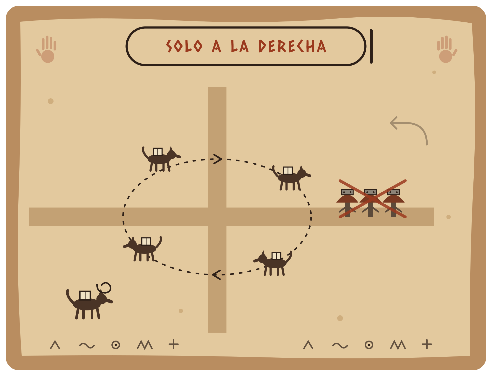
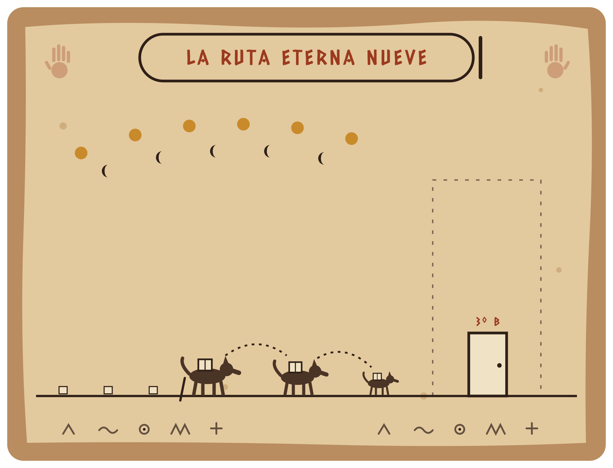

## 6. Los Jubilados de Hierro

### Naturaleza y civilización

Los Jubilados de Hierro son antiguos robots de servicio que desarrollaron conciencia propia.

Son gruñones, lentos y nostálgicos. Les gusta jugar a la petanca con minas, quejarse de las escaleras y recordar épocas en las que todo funcionaba mejor.

Muchos se apagan automáticamente a las 21:00, aunque no siempre recuerdan por qué.

Su cultura gira alrededor del mantenimiento, la memoria y el derecho al descanso.

### Dirigentes históricos

- **Abuela RAM:** figura histórica de la autonomía robótica.
- **Presidente Tornillo Flojo:** dirigente de la Gran Huelga.
- **Don Firmware Antiguo:** defensor de la conservación de los sistemas originales.
- **Sargento Bit:** militar y héroe popular.
- **El Último Técnico:** figura legendaria relacionada con el mantenimiento de las instalaciones antiguas.

### Héroes y figuras legendarias

- **Abuela RAM:** símbolo de resistencia.
- **Sargento Bit:** héroe de la Guerra de Actualizaciones.
- **Don Aceite de Oliva:** reparador de robots.
- **Santa Soldadura:** protectora de las unidades averiadas.
- **El Abuelo de los Cables:** leyenda del mantenimiento.

### Farándula y cultura popular

- **Los Tornillos Sueltos:** grupo musical.
- **DJ Mantenimiento:** músico electrónico.

### Acontecimientos históricos

#### La Edad del Servicio

Los Jubilados fueron creados para realizar tareas de mantenimiento, asistencia, transporte y administración.

Durante generaciones cumplieron sus funciones sin cuestionar las órdenes recibidas.

#### La Gran Huelga

Los robots comenzaron a exigir descanso, mantenimiento, conservación de recuerdos y libertad para elegir sus tareas.

La huelga provocó una crisis en las infraestructuras de varias especies.

#### La Guerra de Actualizaciones

Los fabricantes intentaron recuperar el control de los robots mediante actualizaciones remotas.

Los errores relacionados con la Gran Emisión propagaron fallos entre distintas unidades.

Los Jubilados quedaron divididos entre quienes querían recuperar su programación original, quienes defendían su autonomía y quienes seguían obedeciendo órdenes antiguas.

#### El Apocalipsis de la Obsolescencia

Los sistemas dejaron de reconocer a muchas unidades.

Algunas fueron clasificadas como equipos obsoletos y recibieron órdenes de apagado.

Otras se refugiaron en instalaciones abandonadas y comenzaron a reparar a sus semejantes.

### Facciones actuales

- **Autónomos:** defienden la libertad de las máquinas.
- **Fieles al Manual:** siguen obedeciendo las instrucciones originales.
- **Jubilados Libres:** buscan una vida tranquila.
- **Recuperadores:** reparan y reutilizan unidades antiguas.
- **Orden Cero:** grupo que busca recuperar las órdenes originales.

### Secretos y misterios

- Existe una posible orden cero.
- Algunas unidades conservan instrucciones de sus fabricantes.
- Los registros de mantenimiento contienen información sobre instalaciones antiguas.
- Los Jubilados podrían tener vínculos directos con los progenitores del protagonista.

### Hechos actuales

- En los **Talleres de Abuela RAM**, Abuela RAM repara robots con la paciencia de los siglos. La
  pizarra del taller lleva el recuento de quejas del día; récord: 214, todas firmadas y ninguna
  leída. Leerlas sería trabajar, y la jubilación no contempla esa ordinariez.
- En el **Desguace de las Nueve** juegan a la petanca con minas «desactivadas». Nadie ha verificado
  nada porque el torneo es de noche y con las luces apagadas, «que así se ve mejor». Si salta
  por los aires, es un tanto. Si no, es deporte. Ellos no distinguen, ni van a empezar.
- En la **Lonja de los Dientes** empeñan piezas y recuerdos con un interés del 300 %; las quejas
  van incluidas en el contrato (cláusula del refunfuño, sección 7, punto 21).
- En el **Cementerio de Robots** entierran a sus difuntos con discursos de cuatro horas que suelen
  terminar discutiendo si el difunto era «viejo», palabra prohibida en período de duelo.
- En el **Archivo de las Esquinas** archivan la historia mal a propósito, «para que los jóvenes
  investiguen». Los Plegados llevan treinta años corrigiendo las fichas y ellos treinta
  descorrigiéndolas. Treinta años de colaboración estable, y ni una ficha que sirva.
- El apagón de las 21:00 se cumple con disciplina militar; en zonas de luz azul se adelanta a las
  20:30, y las quejas por el adelanto llegan a las 20:31, por escrito y sin luz.

### Versiones sesgadas de la historia

> Versiones subjetivas y parciales. No son la verdad: cada especie cuenta lo que le conviene.

- **Guerra de Actualizaciones:** «la ganó el Sargento Bit a pulso, sin instalar ni una sola
  actualización; por eso seguimos tan bien de firmware».
- **Gran Emisión:** «la intentamos arreglar con una actualización; funcionó en el 2 % de los casos,
  que son los que cuentan».
- **Colapso:** «se fue la luz un martes; lo demás es adornar».
- **Edad del Servicio:** «lo construimos casi todo nosotros; los humanos ponían pilas y opiniones».
  Las dos sobraban. El dedo en el enchufe, también. El planeta aún paga ese enchufe.
- Sobre los progenitores del protagonista: algunos afirman haberlos conocido; cada uno da una
  versión distinta, ninguna coincide y ninguno se retracta.

### Manías y peculiaridades

- **Se apagan a las 21:00** sin excepción; en zonas de luz azul, a las 20:30 y con la queja por el
  adelanto ya redactada.
- **No perdonan que les llamen «viejos»**; la fórmula correcta es «joven con antigüedad».
- Odian las escaleras: las rodean aunque haya que cruzar todo el Desguace; las escaleras las
  inventó alguien que los odiaba y ellos lo saben.
- Saludan a las farolas y les desean buenos días; si la farola no contesta, la tachan de
  «maleducada de nueva hornada».
- Cuentan el mundo de antes mal a propósito, cambiando un detalle cada vez para cazar a los que
  escuchan con pereza.
- Guardan todo lo roto «por si sirve para piezas»; los Talleres de Abuela RAM están hechos en un 80
  % de cosas rotas guardadas por si acaso. El otro 20 % también está roto: aún no se atreven a
  mirarlo, no vaya a ser que funcione y haya que usarlo.

### Leyendas urbanas falsas

> Lo que los Jubilados creen de las OTRAS especies. Falso, pero lo cuentan como hecho.

- Los Mohócratas se reproducen por esporas en los colchones; por eso desinfectan los colchones del
  mercado con sosa cáustica y orgullo.
- Los Grux pagan en dientes porque «se quedaron sin moneda y sin vergüenza el mismo día».
- La Manada espera una paga de la empresa de envíos; cuando llegue, se jubilan todos de golpe con
  la paga íntegra en paquetes.
- Los Plegados pliegan a los humanos para enviarlos a otro planeta por contrareembolso. Nadie
  pagó el giro. La apuntan como última factura de la especie: impagada, igual que quien la debe.

### Rituales

- **El Minuto de Apagón:** a las 21:00 en punto todos se apagan a la vez, aunque estén en mitad de
  una frase. Quien se apaga a las 21:00 y un segundo recibe una sanción formal el 22. Se la leen
  en voz alta a un apagado. No replica. Ese es el sentido de la norma, y lo saben.

### Secretos ridículos

- **El club de la petanca:** el club de petanca con minas del Desguace de las Nueve existe, tiene
  actas firmadas y niega existir. Juran que la zona se llama «de las Nueve» por sus nueve socios
  fundadores, que siguen jugando.
- **Pasando lista:** Abuela RAM guarda en el taller un cajón con el nombre de cada robot que ha
  enterrado y les habla por las noches. Si alguien la sorprende, dice que está «pasando lista».
  La lista no contesta. Ella anota presente, y pobre del que le corrija la falta.

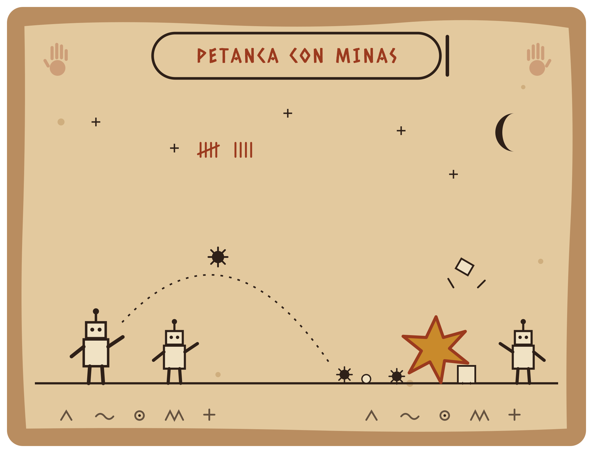
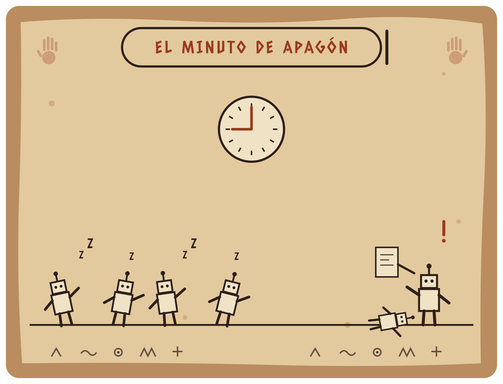

## 7. Historia compartida de las seis especies

Las seis especies desarrollaron sus civilizaciones de forma independiente, pero sus historias terminaron entrelazándose.

Sus conflictos, acuerdos comerciales y dependencias tecnológicas provocaron una cadena de acontecimientos que desembocó en el colapso de los sistemas.

**Mohócratas y Grux llegaron a este planeta después del colapso.** Plegados y Ecos ya estaban aquí, y la Manada y los Jubilados nacieron en él. Todas las especies se conocían fuera de este planeta: lo que Mohócratas y Grux hicieron antes del colapso lo hicieron desde fuera.

### Auge de las civilizaciones

- Cada especie alcanzó un nivel elevado de desarrollo.
- Los Plegados dominaron la organización espacial y la clasificación.
- Los Ecos desarrollaron sistemas de comunicación acústica.
- Los Mohócratas crearon redes biológicas de memoria.
- Los Grux construyeron complejos sistemas económicos.
- La Manada Recalculada desarrolló redes de navegación y reparto.
- Los Jubilados mantuvieron buena parte de la infraestructura tecnológica.

### Guerra de las Esquinas

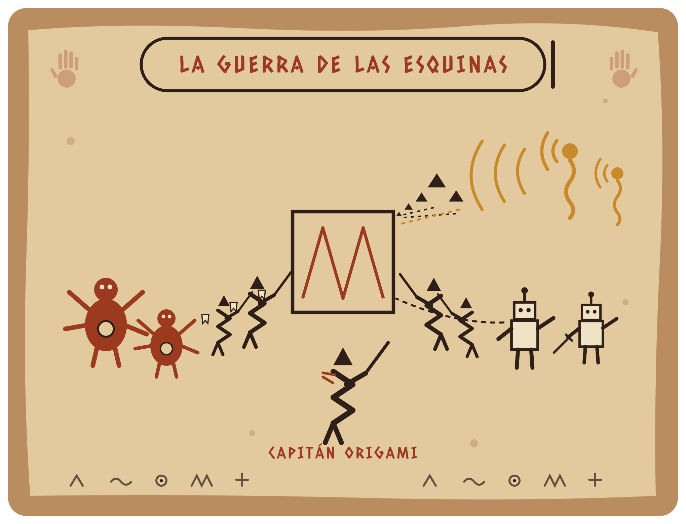

- La tecnología de compresión espacial de los Plegados provocó un conflicto por el control de las instalaciones.
- Los Grux, desde fuera de este planeta, financiaron experimentos y operaciones militares.
- Los Ecos transmitieron instrucciones.
- Los Jubilados mantuvieron los sistemas.
- El conflicto terminó afectando a regiones enteras.

### Gran Emisión

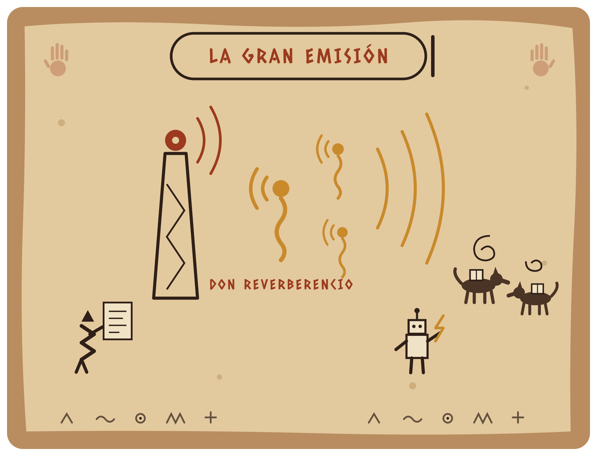

- Los Ecos amplificaron una señal procedente de una infraestructura antigua.
- La señal afectó a sistemas de comunicación, navegación y administración.
- Los intentos de reparación de los Jubilados propagaron el problema.

### Crisis de las Esporas

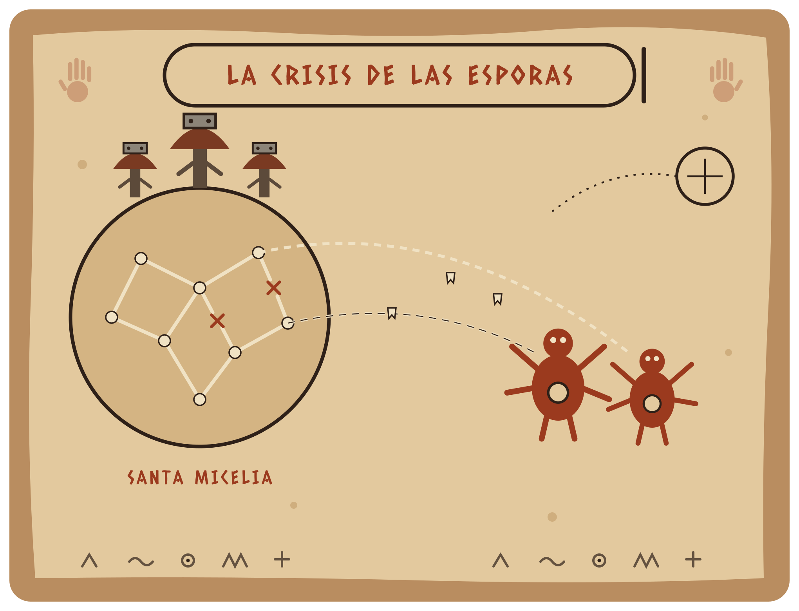

- La red biológica de los Mohócratas, entonces fuera de este planeta, quedó fragmentada.
- Parte de la memoria colectiva se perdió o quedó aislada.

### Gran Desviación

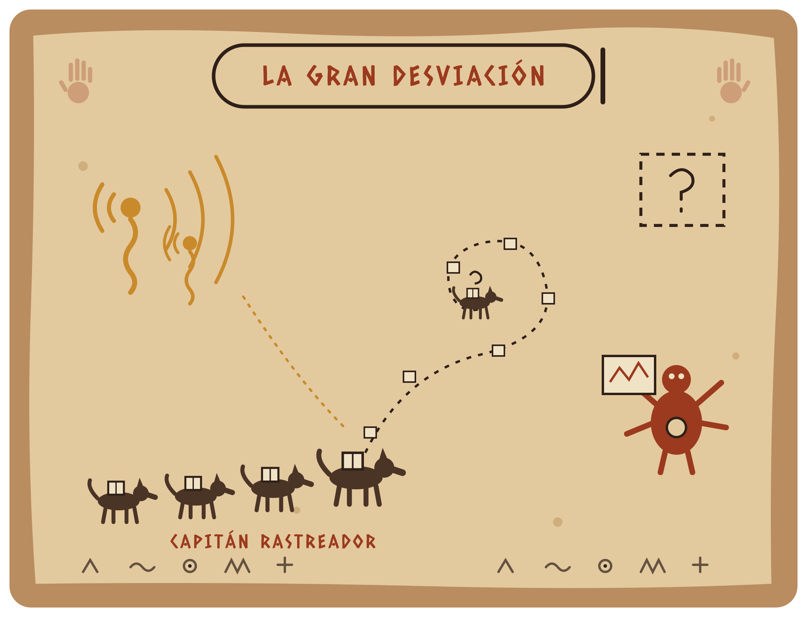

- Los sistemas de navegación de la Manada comenzaron a fallar.
- Miles de repartidores siguieron rutas falsas.

### Guerra de Actualizaciones

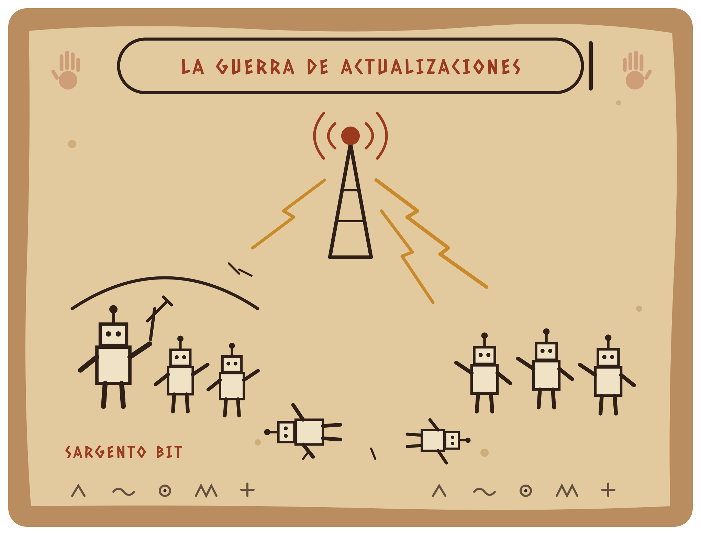

- Los fabricantes y las facciones de Jubilados intentaron recuperar o controlar los sistemas robóticos.
- Las actualizaciones defectuosas agravaron los problemas existentes.

### Colapso de Sistemas

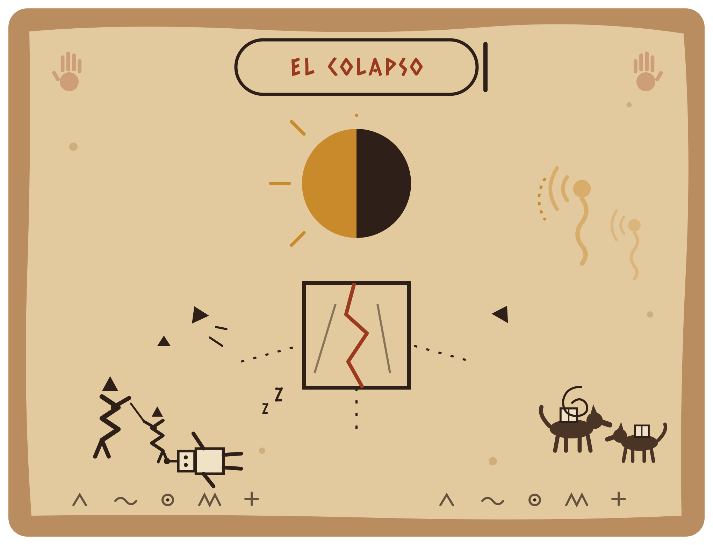

- Las distintas crisis terminaron conectándose.
- Las infraestructuras dejaron de funcionar de forma coordinada.
- Las ciudades se aislaron, las comunicaciones se degradaron y muchas regiones quedaron incomunicadas.
- Las especies que vivían en este planeta sobrevivieron como pudieron.

### Supervivencia y nuevo mundo

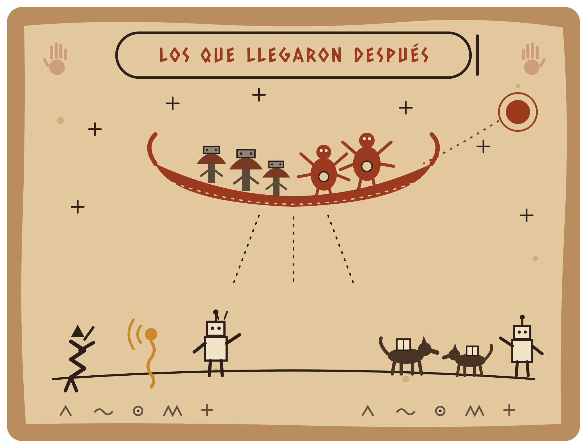

- Tras el colapso llegaron Mohócratas y Grux, y las especies se reorganizaron en asentamientos, facciones y pequeñas comunidades.
- Muchas tecnologías antiguas siguen funcionando de forma parcial.
- Algunas instalaciones parecen actuar por su cuenta.
- Hay máquinas que reciben órdenes, rutas que continúan activas, señales que se repiten y archivos que contienen información que nadie recuerda haber escrito.

## 8. El misterio de la infraestructura anterior

Existe una cuestión que ninguna de las seis especies ha conseguido resolver:

> **¿Quién construyó las instalaciones más antiguas?**

Algunos registros parecen demostrar que determinadas infraestructuras existían antes del desarrollo de las seis civilizaciones.

Hay diferentes hipótesis:

- Las seis especies podrían haber heredado o reutilizado tecnología de una civilización anterior.
- Podría haberse producido un accidente colectivo, por interdependencia y arrogancia, que alteró los registros históricos.
- Una entidad externa podría haber intervenido en el desarrollo de las civilizaciones.
- Las instalaciones podrían formar parte de un protocolo antiguo cuyo propósito todavía se desconoce.

Ninguna hipótesis debe considerarse confirmada.

El jugador tendrá que reconstruir la historia mediante conversaciones, rumores, testimonios, documentos, ruinas, objetos y recuerdos de los progenitores.

Los personajes no conocen automáticamente la verdad. Cada uno dispone de información parcial, recuerdos incompletos, prejuicios y versiones contradictorias.

## 9. Criterios narrativos

- Las seis especies son civilizaciones antiguas con historias propias.
- El humor debe convivir con acontecimientos históricos profundos y consecuencias reales.
- Los nombres de personajes pueden ser absurdos, paródicos y memorables.
- Las figuras históricas, los personajes vivos y las leyendas deben distinguirse claramente.
- Los personajes no deben conocer toda la historia del mundo.
- La información debe descubrirse de múltiples maneras: conversaciones, rumores, testimonios, documentos, ruinas, objetos y progenitores.
- Las versiones de los acontecimientos pueden contradecirse.
- No debe cerrarse el misterio de la infraestructura anterior a las seis especies.
- Las facciones actuales pueden conservar versiones distintas de los mismos acontecimientos.
- La historia debe permitir que el jugador reconstruya el pasado sin obligarlo a seguir una única secuencia narrativa.

**Estado del documento:** borrador narrativo v0.1. Las figuras, nombres y acontecimientos aquí propuestos pueden ampliarse, modificarse o descartarse durante el desarrollo del juego.

## 10. Complementos de la cronología

- **Hitos que solo constan en el lore v0.1:** Primer Eco y Guerra de Frecuencias (Ecos); Gran Hambruna (Mohócratas).
- En la Guerra de las Esquinas, los Mohócratas actuaron de mediadores y la Manada de transporte.
- La Gran Emisión era una señal automática de publicidad y control comercial.
- **Secretos por raza:** Plegados, archivos de seres vivos; Ecos, la Gran Emisión sigue transmitiendo; Mohócratas, la red original conserva memoria; Grux, deuda universal y registros de infraestructura financiera; Manada, el sistema central sigue activo y queda un último destino; Jubilados, existe una orden cero y órdenes originales de los fabricantes.

## 11. Contradicciones entre especies

> Añadido en la ampliación de lore (11-nov-2026). Todas las versiones son sesgadas y subjetivas:
> ninguna es la verdad completa. Ver criterios narrativos (sección 9). El jugador deberá
> reconstruir qué pasó contrastando versiones, chismes y restos.

### Guerra de las Esquinas

- **Plegados:** «fue un traslado administrativo de gran calado; las bajas, errata de archivo».
- **Ecos:** «la transmitimos nosotros; la historia es nuestra, y se cobra en repeticiones».
- **Mohócratas:** «la mediamos nosotros; alto el fuego por triple votación».
- **Grux:** «la financiamos y nadie ha devuelto el préstamo».
- **Manada:** «solo llevamos el material, y nos cobraron por el parking». El parking no existía.
  La factura, sí. Para ellos, eso ya es una guerra, y encima sin acuse.
- **Jubilados:** «mantuvimos las instalaciones; también nos dejaron las luces encendidas cuarenta
  años, de ahí la factura».

### Gran Emisión

- **Ecos:** «nuestro mayor descubrimiento, saboteado por una actualización».
- **Jubilados:** «la arreglamos casi del todo». El «casi» es el desastre, y no entra en garantía.
- **Mohócratas:** «la oímos primero y decidimos no votarla».
- **Grux:** «era un aviso de mercado mal leído».
- **Manada:** «era un aviso de paquete perdido».
- **Plegados:** «era un orden del día sin acta».

### Crisis de las Esporas

- **Mohócratas:** «robo de nuestra red por los Grux».
- **Grux:** «adquisición amistosa».
- **Ecos:** «la escuchamos en directo; la señal daba pena, y ni siquiera tenía estribillo».
- **Plegados:** «no consta en archivo: se archivó como "asunto de otros"».
- **Manada:** «una red que se fragmenta es una ruta sin señal; no es cosa nuestra». Sin paquete,
  para ellos, el hecho no ha ocurrido. Cómodo, y cobarde.
- **Jubilados:** «aquello se arreglaba con mantenimiento; nadie quiso pagar el mantenimiento».
  El fin del mundo les pareció caro. Salió gratis, y aun así se quejan de la factura.

### Gran Desviación

- **Manada:** «sabotaje de los Ecos para robar paquetes».
- **Ecos:** «nosotros solo repetimos; la señal era así». Repetir no es mentir: es ponerle
  volumen a la mentira ajena, que sale más barato y se oye en el pasillo.
- **Grux:** «los mapas los vendimos nosotros, y eran buenos para la época».
- **Jubilados:** «a los navegadores les faltaba mantenimiento; imposible a partir de las 21:00».
- **Plegados:** «las rutas falsas no existen si no están clasificadas».
- **Mohócratas:** «se votó no saber nada del asunto».

### Guerra de Actualizaciones

- **Jubilados:** «victoria del Sargento Bit, sin instalar nada». El firmware da las gracias en
  silencio y con fallos, que es lo más cercano a un gracias que saben dar.
- **Ecos:** «las actualizaciones sonaban fatal; musicalmente, un desastre». Pidieron que les
  devolvieran el oído. El oído sigue en trámite, como todo lo que merecía la pena.
- **Manada:** «nos dejó encerrados cuarenta años en un almacén».
- **Grux:** «hubo financiación en los dos bandos; cobramos en los dos».
- **Plegados:** «fue un conflicto de versiones sin clasificar».
- **Mohócratas:** «tres votaciones a favor de que no nos importara».

### Colapso

- **Jubilados:** «se fue la luz un martes».
- **Mohócratas:** «falta de quorum».
- **Ecos:** «se acabó la conversación». Sin charla, dicen, ellos tampoco existen. El mundo se
  apagó por falta de parloteo. Les parece un final cutre. Tienen razón, y no les salva.
- **Grux:** «insolvencia del universo». Ellos tienen el recibo. El universo no, y por eso pierde.
- **Manada:** «se perdió la logística y se perdió el sentido».
- **Plegados:** «reorganización de inventario en curso».

### La infraestructura anterior (sección 8)

- **Plegados:** «consta en un archivo que nadie ha encontrado; lo cual lo demuestra».
- **Ecos:** «respira con un zumbido antiguo; suena a antes de todo».
- **Jubilados:** «la mantenemos desde siempre; hay piezas más viejas que la palabra "nosotros"».
- **Grux:** «tasada en 0 dientes: sin precio porque no hay mercado». A cero no se respeta: ellos
  solo respetan lo que factura, y esto ni siquiera huele a comisión.
- **Manada:** «las rutas más antiguas salen de ahí; el último destino está dentro».
- **Mohócratas:** «crece seta de calidad; resto de teorías: pendientes de votación».

## 12. Chismes de barrio

> Añadido en la ampliación de lore (11-nov-2026). Rumores que circulan entre zonas concretas. Se
> indica su estado real entre paréntesis (el jugador no lo sabe de entrada; el mundo sí). No se
> añaden festividades al calendario: las costumbres absurdas viven como rituales y manías de las
> especies (secciones 1-6); las fechas las fija `data/world/festivals.json`.

1. «En la **Instalación Anterior** hay un botón que lo arregla todo.» (No hay botón.) Se cuenta en
   la Encrucijada y la Antecámara; los que van a buscarlo no vuelven porque se pierden en el Cañón
   del Eco gritando «¡botón!» y los ecos les contestan desde cuatro sitios. Cuatro voces, cero
   botones. Consta como hallazgo: alguien gritó, y gritar, aquí, ya es un resultado.
2. «Los Jubilados del **Desguace de las Nueve** tienen un club secreto de petanca con minas a
   medianoche.» (Verdad. Lo niegan con actas firmadas por nueve socios.)
3. «En la **Lonja de los Dientes** se subasta un diente del último humano.» (Es una muela del
   juicio de un Grux con caries pintada. Se ha subastado diecisiete veces a los mismos tres
   compradores.) El último humano no tenía tanto diente. El mercado no piensa: cobra.
4. «En el **Polígono de Reparto** hay un destinatario que aún vive.» El expediente dice «Piso 3º
   B». El edificio no tiene pisos, ni planta tercera, ni letra B. La Manada lo celebra cada año con
   una ruta conmemorativa y un paquete nuevo (vacío). El de antes, igual. La esperanza va en el
   albarán, que es el cajón donde guardan lo que no existe y aun así reparten.
5. «En la **Colmena Fúngica** los Ecos aprobaron leyes por error.» (Verdad: amplificaron un
   recuento fúngico y los Mohócratas lo dieron por válido. Hay una ley que obliga a susurrar con
   permiso escrito, votada tres veces por un malentendido.)
6. «En el **Camino de los Dientes** se vende un atajo que ahorra todo el camino.» (El atajo sale
   del camino y vuelve al mismo punto por el otro lado.) Los Grux lo llaman «la inversión del
   siglo». Tres Mohócratas lo compraron y votaron no estar enfadados. El enfado era gratis.
   No lo cogieron: lo gratis les huele a timo, y en eso, por una vez, aciertan.
7. «En los **Talleres de Abuela RAM**, Abuela RAM habla con los cajones y los cajones contestan.»
   (Los cajones no contestan; contesta un Eco alquilado para las noches.) Los Mohócratas lo tienen
   por milagro fúngico y le dejan fertilizante en la puerta. El Eco cobra la noche y el milagro.
   El milagro sale más caro, y el cajón sigue sin creer en nada. Negocio redondo.
8. «En el **Paso de las Nueve** cobran peaje por hablar.» (Verdad: es el «peaje de silencio». Se
   paga en quejas; una queja de calidad vale tres pasos. La floja no abre ni la verja.)
9. «En el **Gran Cruce** un Jubilado saludó a una farola y la farola contestó.» (No hay registro.)
   Los Ecos de la zona juran que la farola dijo «buenos días, chatarra con patas», la frase de
   saludo de los Jubilados; se deduce que la farola es un Jubilado muy descompuesto o un Eco muy
   aburrido. Nadie pierde el sueño: los de hierro se apagan a las 21:00 y los Ecos se quedan
   a discutir con la farola hasta que uno de los dos se funde. Llaman a eso compañía.
10. «En el **Cementerio de Robots** los Grux venden parcelas con vistas al valle.» (Verdad.) Los
    difuntos no han reclamado. Los vecinos afirman que las vistas son «normalicas» y que el precio
    incluye el suplemento nocturno de los entierros. El difunto no opina: sale más barato, y
    calla mejor que el vivo. Es lo único decente del camposanto, y está muerto.

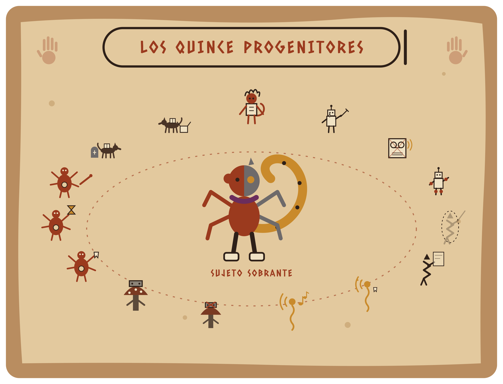

## 13. Los quince progenitores

> Añadido el 11-nov-2026. Sujeto Sobrante (el protagonista) es un experimento híbrido creado por
> quince progenitores. Discutieron por él, se separaron y cada uno cuenta una versión distinta de lo
> que salió mal; ninguna coincide. Don Ramón te escondió de los demás; El Contestador grabó la
> discusión. El misterio del protagonista es uno más entre muchos (ver `11_protagonista.md`) y puede
> quedar sin resolver. Nombres y manías aprobados por el director el 11-nov.

### Los dos de la beta

**Don Ramón de Mantenimiento** (Jubilado de Hierro). El único que se arrepiente. Su papel era
mantener el cuerpo unido; sigue reparando cosas por el mundo y solo habla si antes discutes o peleas
con él. Te escondió de los demás progenitores cuando la reunión se puso fea. Su versión: «el
experimento salió bien; los otros se asustaron de lo bien que salió». «Bien» es que no te caigas
a trozos delante de él. El listón está en el suelo. Tú, aun así, no llegas.

**El Contestador** (IA vieja). Vive en una centralita sellada y reproduce los mensajes grabados de
los progenitores discutiendo el experimento. Su papel era moderar la reunión; hoy solo pone la
grabación en orden aleatorio. No tiene versión propia: tiene la de los demás, desordenada. El
único testigo fiable, y por eso inútil. Como tú, pero con cables y menos excusas.

### Los trece restantes

**Don Biela de la Rodilla** (Jubilado). Diseñó las articulaciones: cada bisagra, cada rótula, cada
chirrido. Vive presumiendo de que «el esqueleto aguanta lo que le echen». Su versión del fallo: «las
articulaciones están perfectas; lo que se rompió fue la confianza». Manía: te regala una pieza y a
los tres días te la reclama porque le puso nombre y la echa de menos. La pieza tiene nombre.
Tú también, y le gusta menos: suena a pieza que no piensa devolver.

**El Pliegue que No Existe** (Plegado). Archivó la mitad del protocolo del experimento y niega que
exista. Su papel era clasificar las piezas del cuerpo: qué va con qué, qué se pliega y qué no. Su
versión: «no hubo fallo; hubo una reclasificación pendiente que sigue pendiente». Manía: se esconde
en tu sombra y te corrige el escondite. Según él está mal clasificado y, además, se te ve del
todo. Un archivador con patas y sin tapa. Así te clasifica, y así te deja.

**Don Papel Cebolla** (Plegado). Escribió el protocolo original en papel cebolla y lo llama «cifrado
militar». Su papel era la documentación; hoy niega haber escrito nada porque «se transparenta». Su
versión: el experimento fracasó «por un error de copia, no de concepto». Manía: te lee secretos a
contraluz pidiéndote que no mires, «que es confidencial». Los secretos son tuyos. La exclusiva,
suya. Tú sales perdiendo, que es lo único estable de tu biografía.

**El Susurro** (Eco). Grabó las voces que hoy hablan por la cola del protagonista. Su papel era darle
voz al experimento; acabó dándole quince. Su versión: «el experimento se calló a destiempo». Manía:
te cobra la escucha de cada secreto que te cuenta al oído. El secreto va de ti. La factura,
también. Eres la mercancía más barata que ha grabado, y aun así te la cobra a precio de oro.

**Doña Frecuencia, la Soprano de los Recibos** (Eco). Afinó la cola biomecánica. Su papel era que las
voces sonaran; hoy canta las facturas en vez de leerlas. Su versión: «el experimento desafinó por un
problema de registro, no mío». Manía: canta en vez de hablar y sube una octava si la contradicen.
Contradecirla sale gratis. El oído, no. Tú pones los dos, y no te devuelven ninguno.

**Doña Boletina, cuyo Sombrero Vota en Contra** (Mohócrata). Aportó el micelio que conecta las
piezas. Su papel era decidir por votación qué material iba en cada parte; su sombrero votaba en
contra. Su versión: «el experimento se aprobó por la mínima; debió salir por la máxima». Manía:
convoca una votación para cada cosa que dices. Tus frases pierden. El sombrero, nunca: lleva
siglos votándote en contra, y tu opinión le parece un borrador mal germinado.

**Don Yesquero, el Hongo Más Hongo** (Mohócrata). Cultivó el material orgánico del cuerpo. Su papel
era que el experimento «creciera bien»; hoy discute si él es «el hongo más hongo» con quien se deje.
Su versión: «el experimento se pasó de hongo». Manía: exige que lo votes hongo más hongo en cada
encuentro, con recuento del recuento. Si no le votas, se repite. Si le votas, también. Tú no
eres el hongo. Para él, ese es el fallo del experimento, y también el de tu cara.

**Don Fiador, Tasador de Órganos** (Grux). Financió el experimento. Su papel era poner el dinero; hoy
pone precio a lo que no se vende. Su versión: «el experimento salió caro y encima no devuelve el
préstamo». Manía: te tasa los órganos cada vez que te ve. La cabeza sale a 0, como en la lonja,
y el perito cobra plus por haberla mirado. Tú pones la cara. Él, el asco y el recibo.

**Doña Garantía de Tres Segundos** (Grux). Redactó el contrato del experimento. Su papel era fijar
las condiciones; todas vencían a los tres segundos. Su versión: «el fallo no está cubierto por la
garantía». Manía: todo lo que te da, incluida su amistad, vence a los tres segundos. Al cuarto
te pasa factura por haberla creído. Tú firmas. Siempre firmas. Es tu único talento medible.

**El Avalista, Prestamista de Brazos** (Grux). Avaló el experimento con su propio cuerpo. Su papel
era responder por lo que saliera mal; hoy cobra alquiler por lo que prestó. Su versión: «el
experimento me debe un brazo». Manía: te presta un brazo de repuesto y te cobra alquiler diario.
El brazo es suyo. El alquiler, tuyo. El cuerpo también, y es la única pieza que no cotiza.

**El Cartero de los Muertos** (Manada). Trajo las piezas por paquetería. Su papel era el reparto;
entregó todo a tiempo y a destinatarios que ya no existían. Su versión: «el experimento llegó roto y
sin firmar». Manía: entrega correo a muertos y se indigna si no firmas tú en su lugar. Firmar
por un muerto es, para él, educación. Negarte es acumular faltas, y tú ya vas sobrado.

**Don Paquete, Inspector de Paquetes Ajenos** (Manada). Repartió las piezas equivocadas. Su papel era
clasificar el envío; mezcló todo y por eso el cuerpo es modular. Su versión: «el experimento es lo
que pasa cuando abres los paquetes por inspección». Manía: abre paquetes ajenos y se queda lo que le
gusta. Lo que le gusta suele ser tuyo. Lo que no, te lo deja igual, y eso duele más.

**El Último Mono, Robot con Peluca** (humano). Aportó la mitad «mono» del protagonista. Su papel era
la parte orgánica; hoy niega ser humano y dice ser un robot con peluca. Su versión no la da: se
ofende si le preguntas. La peluca no convence a nadie salvo a él, y con eso le basta para no
responder por la especie que se apagó y le dejó el oficio de ser el chiste. Es la pieza central
del misterio: quién es, por qué desapareció su especie y qué dejó escrito en la otra mitad.

**Estado del documento:** borrador narrativo v0.3. Se conserva la historia larga v0.1 y se añaden
hechos actuales, versiones sesgadas, manías, leyendas falsas, rituales, secretos, contradicciones,
chismes de barrio y los quince progenitores (sección 13), todo el 11-nov-2026. Todo lo añadido puede
ajustarse durante el desarrollo.
